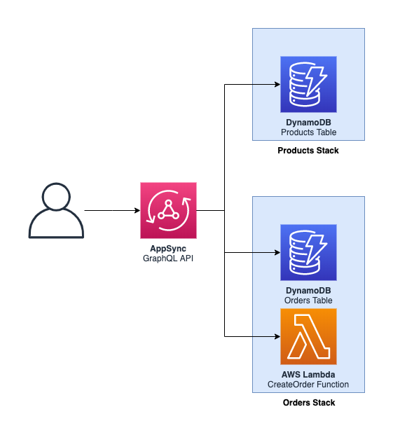

# ACME Shop: Storefront API

GraphQL API behind the web shop and the mobile app; aggregates catalogue, orders, delivery and customer data.

- Component: `storefront-api` (service, production)
- Owner: **storefront-team**
- System: `storefront`

## Origin and license

This repository is derived from [aws-samples/aws-serverless-ecommerce-platform](https://github.com/aws-samples/aws-serverless-ecommerce-platform) at commit [`3b9ef36`](https://github.com/aws-samples/aws-serverless-ecommerce-platform/tree/3b9ef36dd3e338c8ab697c2bcb1b672e064e303c), split out of that monorepo with its commit history and modified as listed below. Original code: Copyright 2019 Amazon.com, Inc. or its affiliates, licensed under MIT-0 (see [LICENSE](LICENSE)).

ACME Retail Group is a fictional company used for demos. This repository is not affiliated with, or endorsed by, Amazon Web Services.

## Changes from upstream

- Split out of the upstream monorepo into one repository per service, with history.
- The shared `ecom` library is installed from [acme-shop-ecom-lib](https://github.com/kaku0/acme-shop-ecom-lib) instead of a relative path.
- SSM-backed template parameters have a `dev` default, so the template can be read on its own.
- `catalog-info.yaml` (Backstage) describes ownership, system, APIs and dependencies.

---

Frontend API service
================

  

## API

See [resources/api.graphql](resources/api.graphql) for the GraphQL API.

## Events

_None at the moment._

## SSM Parameters

This service defines the following SSM parameters:

* `/ecommerce/{Environment}/frontend-api/api/arn`: ARN for the GraphQL API
* `/ecommerce/{Environment}/frontend-api/api/id`: ID of the GraphQL API
* `/ecommerce/{Environment}/frontend-api/api/url`: URL of the GraphQL API